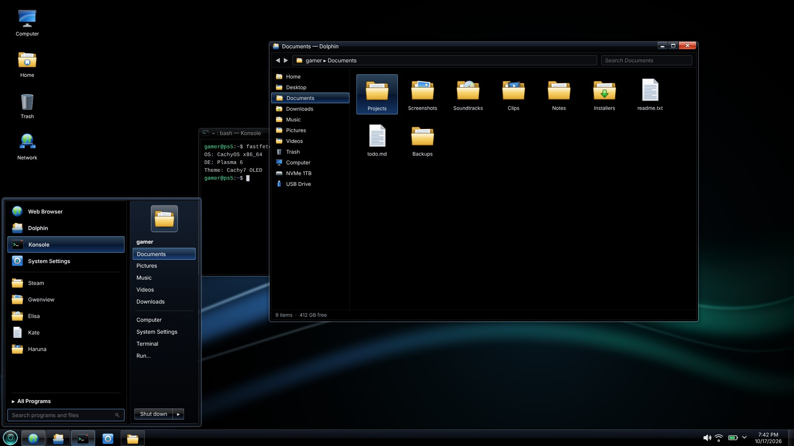
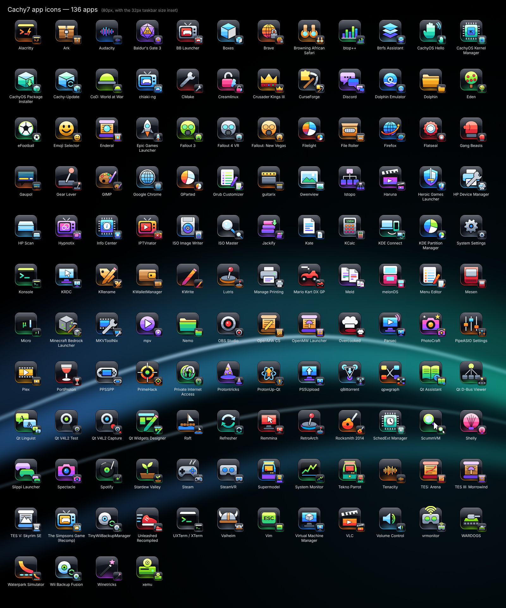

# Cachy7 OLED

A Windows 7 Aero look for KDE Plasma 6 on CachyOS — glass taskbar, Aero window
frames with the classic min/max/red-close buttons, a two-column start menu behind a
glass orb, Win7-flavoured icons — rebuilt on pure OLED black. Every place Windows
had its flag logo shows the CachyOS logo instead.



## What's in the box

| Part | Installed as | Where to find it in System Settings |
|---|---|---|
| OLED color scheme (Aero-blue accents) | `Cachy7OLED` | Colors & Themes → Colors |
| Plasma style (glass taskbar, Win7 task buttons, glass popups) | `cachy7-oled` | Colors & Themes → Plasma Style |
| Window decoration (Aero frame, Win7 caption buttons) | `Cachy7OLED` (Aurorae) | Colors & Themes → Window Decorations |
| Icon theme (folders, Computer, Recycle-bin style trash, drives…) | `Cachy7` (inherits Breeze Dark) | Colors & Themes → Icons |
| Optional: 136 app icons, glossy dark tiles with bright 80s-style emblems | `Cachy7 Apps` | `cachy7-oled app-icons on/off` |
| Start menu widget with the CachyOS orb | `Cachy7 Start Menu` | Add Widgets |
| Global theme + Win7 taskbar layout + "Starting CachyOS" splash | `Cachy7 OLED` | Colors & Themes → Global Theme / Splash Screen |
| OLED aurora wallpaper | `Cachy7 OLED Aurora` | Wallpaper |

## Install

Open a terminal (or SSH into the machine) and paste:

```bash
git clone https://github.com/Brenyd/cachy7-oled.git
cd cachy7-oled
./install.sh
```

It asks whether to also swap your panel for the Windows 7 taskbar. To skip the question:

```bash
./install.sh --layout      # yes, give me the Win7 taskbar
./install.sh --no-layout   # keep my current panel
```

It also asks whether you want the Win7-style **app icons** (add `--app-icons` or
`--no-app-icons` to skip the question). Both choices are remembered for updates.

<details>
<summary>No git? Download without it</summary>

```bash
curl -L https://github.com/Brenyd/cachy7-oled/archive/refs/heads/main.tar.gz | tar xz
cd cachy7-oled-main
./install.sh
```

Or click the green **Code** button → **Download ZIP**, unzip it, open a terminal in the
folder and run `bash install.sh`.
</details>

No root needed; everything goes into `~/.local/share` and the `cachy7-oled` command
lands in `~/.local/bin`. Works over SSH.

**Gaming mode:** if Plasma isn't running, settings are saved now and the taskbar +
wallpaper finish applying the next time you enter desktop mode.

## Update

```bash
cd cachy7-oled
git pull
./install.sh
```

The installer checks your panel: if the Cachy7 start menu is already on it, it leaves
your panel alone; if it's missing (for example after `cachy7-oled revert`), it offers
to set up the Windows 7 taskbar again. Your pre-theme backup is kept either way.

Plasma keeps the old start menu code loaded until it restarts, so after updating run
`systemctl --user restart plasma-plasmashell` (or log out and back in).

## Undo — one command

Before it changes anything, `apply` copies your current config (panel layout,
wallpaper, colors, icons, window frame, splash) to `~/.local/share/cachy7-oled/snapshot`.

```bash
cachy7-oled revert      # exactly your old desktop back, theme stays installed
cachy7-oled apply       # switch to it again (add --layout for the taskbar)
cachy7-oled uninstall   # revert + delete all theme files
cachy7-oled status      # installed? applied? start menu on panel? backup from when?
cachy7-oled app-icons on|off   # Win7-style app icons (off restores your app shortcuts too)
cachy7-oled panel-height 34    # taskbar height in pixels (24-80)
```

Re-applying or updating never overwrites that first backup, so `revert` always goes
back to your pre-Cachy7 desktop. Log out/in after reverting so open apps refresh.

## Optional: install as a pacman package

```bash
git clone https://github.com/Brenyd/cachy7-oled.git && cd cachy7-oled
makepkg -si                        # files go to /usr/share, command to /usr/bin
cachy7-oled apply --layout         # as your normal user
# to remove:
cachy7-oled revert && sudo pacman -R cachy7-oled-theme
```

### The CachyOS logo

The installer reads `LOGO=` from `/etc/os-release` and copies the matching logo it
finds under `/usr/share/icons` or `/usr/share/pixmaps` into the orb, the boot splash
and the `start-here` icon. To pick one by hand:

```bash
./install.sh --logo /path/to/cachyos-logo.svg
```

Or right-click the orb → Configure Cachy7 Start Menu → *Orb logo* (icon name or file path).

## App icons

Optional (`cachy7-oled app-icons on`/`off`). Every app gets a Win7-era glossy tile with an original emblem of what it does (no brand
logos are copied). They live in their own icon theme, *Cachy7 Apps*, which adds them on top of the base Cachy7 icons, so most apps pick them up automatically. Apps
whose shortcut points at an image file (AppImages, some launchers) are re-pointed by
`cachy7-oled apply`: your own shortcuts are backed up first, and system ones get a
personal override, so `cachy7-oled revert` restores them exactly.



To add icons for more apps, edit the `APPS` table in `tools/build_appicons.py`.

## The start menu

- Left column: pinned apps (bold), frequently used apps, **All Programs**, and
  *Search programs and files* (KRunner results; ↑/↓ + Enter work).
- Right-click any app → **Pin to Start Menu** / **Unpin**.
- Right column: your name, Documents, Pictures, Music, Videos, Downloads, Computer,
  System Settings, Terminal, Run… — the picture frame swaps to the hovered item's icon,
  like Windows 7.
- **Shut down** and the ▸ menu: Switch user, Log off, Lock, Restart, Sleep.
- The Meta key opens it.

## If something's off

- App icons not changing: run `cachy7-oled doctor`. It checks which icon theme Plasma is
  using and looks up every app icon name, listing any that resolve somewhere else.

- Start menu shows an error or no apps: run
  `journalctl --user -b | grep -i cachy7` and check the output — the widget logs which
  part of Plasma's launcher API it could not use.
- Window buttons in the wrong order: System Settings → Window Decorations →
  Configure Titlebar Buttons, or rerun `cachy7-oled apply`.
- Needs Plasma 6.

## Rebuilding the artwork

The SVGs (Plasma style, window frame, icons, orb) are generated by the scripts in
`tools/` (Python 3, no dependencies). Run them in this order, since `build_icons.py`
recreates the icon folder: `python3 tools/build_theme.py .`, `python3 tools/build_icons.py .`,
`python3 tools/build_appicons.py .`, `python3 tools/build_misc.py .`

## License

GPL-2.0-or-later. The CachyOS logo is not included; it is copied from your own system at install time.
